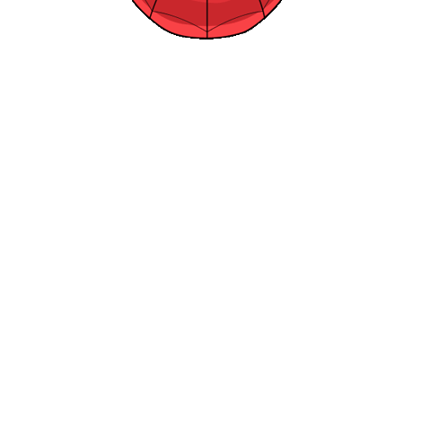

### Hi there! 

I'm [**Arushi**](https://www.linkedin.com/in/arushi-b-44787a224/), a CS undergrad in Toronto.

🎓 I'm currently in school and like turning ideas into code, chasing personal bests at the gym, and making tech/fitness related content. 

I'm excited by tech that makes lives better. Also mildly obsessed with AI 🤖 and hardware 🛠️ — basically anything I can build, break, and hopefully fix.

<h2> Favourite Languages  </h2>

